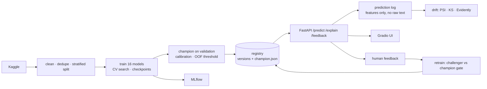

# 🛡️ SpamGuard — production-grade SMS spam detection

Leakage-safe training · 16-model benchmark · calibrated probabilities · policy-driven threshold · versioned model registry ·
FastAPI + Gradio · explainability · drift monitoring · feedback-driven retraining · Docker · CI/CD · DVC · MLflow.

## Quick start

**Google Colab (recommended for you):** upload `sms-spam-mlops.zip` to My Drive, open `notebooks/SpamGuard_Colab.ipynb`, add Colab Secrets
`KAGGLE_USERNAME` / `KAGGLE_KEY`, *Runtime ▸ Run all*. Everything (data, checkpoints, models, metrics, plots) is written to
`My Drive/sms-spam-mlops/`; after a disconnect, Run all again and finished models are skipped.

**Local:**
```bash
pip install -r requirements-dev.txt && pip install -e . --no-deps
export KAGGLE_USERNAME=... KAGGLE_KEY=...
python -m spamguard.train                 # full benchmark (resumable);  --fast for a 4-minute smoke test
uvicorn spamguard.api:app --port 8000     # API: /docs   UI: /ui   metrics: /metrics
pytest -q                                 # 42 tests
docker compose up --build                 # API + MLflow
```
No Kaggle account? `python -m spamguard.train --source local --local-path data/sample/spam.csv` (UCI sample is bundled).

## What changed versus the original notebook
| Original | Now |
|---|---|
| TF-IDF fitted on **all** data before splitting (leakage) | Vectoriser lives inside an sklearn `Pipeline`; fitted on training folds only (tested) |
| Unstratified split, accuracy + precision only | Stratified train/val/test; 20+ metrics, bootstrap CIs, McNemar tests |
| `model.pkl` + `vectorizer.pkl` saved separately | One checksummed bundle per version, champion pointer, one-line rollback |
| Fixed 0.5 threshold | Threshold chosen by business policy on out-of-fold predictions |
| NLTK + Streamlit prototype | FastAPI + Gradio, input validation, optional API key, Prometheus-style metrics |

## Architecture

Layout: `src/spamguard/{data,preprocessing,models,evaluation,train,registry,predictor,explain,monitoring,retrain,api,app_gradio}.py`,
`tests/`, `params.yaml`, `dvc.yaml`, `Dockerfile`, `.github/workflows/ci.yml`, `notebooks/`.

## Evaluation protocol
* **train** → fit + random-search CV (PR-AUC). **val** → pick champion and calibration method (log-loss). **test** → used once for the report.
* Threshold: maximise recall subject to precision ≥ 0.99 (`params.yaml`; alternatives `max_f1`, `max_fbeta`, `min_cost`), tuned on 5-fold
  out-of-fold predictions over train+val, because ~100 validation spam messages are too few for a stable precision floor
  (an early version tuned on val alone gave test precision 0.94 instead of 1.00).
* Metrics: accuracy, balanced accuracy, precision, recall, specificity, NPV, F1/F2/F0.5, MCC, Cohen's κ, FPR, FNR, PR-AUC, ROC-AUC, log-loss,
  Brier, ECE, confusion matrix, latency, size; plus reliability diagrams, slices by message length, obfuscation robustness, error analysis CSVs.

## Example results
Run on the **bundled UCI sample** (5,157 unique messages after cleaning; test = 774 msgs, ~96 spam), full search budget, 1 CPU, 4.4 min of
fresh compute on top of resumed checkpoints. Metrics are at each model's own val-tuned threshold (precision floor 0.99):

| Model               |   Precision |   Recall |     F1 |   PR-AUC |   ROC-AUC |    MCC |    ECE |   ms/msg |
|:--------------------|------------:|---------:|-------:|---------:|----------:|-------:|-------:|---------:|
| lightgbm            |      1      |   0.8229 | 0.9029 |   0.9931 |    0.9987 | 0.896  | 0.0101 |    6.053 |
| extra_trees         |      1      |   0.8125 | 0.8966 |   0.992  |    0.9988 | 0.8897 | 0.0237 |   18.763 |
| rbf_svm             |      1      |   0.8333 | 0.9091 |   0.9917 |    0.9972 | 0.9023 | 0.0098 |    5.368 |
| linear_svm          |      1      |   0.7812 | 0.8772 |   0.9911 |    0.9974 | 0.8705 | 0.0118 |    5.475 |
| voting_soft         |      1      |   0.7917 | 0.8837 |   0.9904 |    0.9973 | 0.8769 | 0.0096 |    6.814 |
| bernoulli_nb        |      1      |   0.8646 | 0.9274 |   0.9904 |    0.9953 | 0.921  | 0.0055 |    5.093 |
| random_forest       |      1      |   0.6979 | 0.8221 |   0.9895 |    0.9985 | 0.8181 | 0.0387 |   18.651 |
| sgd_modified_huber  |      1      |   0.8438 | 0.9153 |   0.9894 |    0.994  | 0.9086 | 0.0132 |    4.321 |
| stacking            |      1      |   0.7917 | 0.8837 |   0.9892 |    0.997  | 0.8769 | 0.0043 |    6.846 |
| adaboost            |      1      |   0.7604 | 0.8639 |   0.9888 |    0.9979 | 0.8576 | 0.3124 |   15.032 |
| xgboost             |      1      |   0.7604 | 0.8639 |   0.9881 |    0.9979 | 0.8576 | 0.0089 |    7.061 |
| logistic_regression |      1      |   0.5833 | 0.7368 |   0.9868 |    0.9977 | 0.7422 | 0.1069 |    4.303 |
| complement_nb       |      1      |   0.8229 | 0.9029 |   0.9854 |    0.9965 | 0.896  | 0.4858 |    4.362 |
| multinomial_nb      |      1      |   0.8229 | 0.9029 |   0.9846 |    0.9962 | 0.896  | 0.0115 |    4.512 |
| knn_cosine          |      0.9583 |   0.9583 | 0.9583 |   0.9841 |    0.9931 | 0.9524 | 0.0132 |   12.428 |
| decision_tree       |      0.9462 |   0.9167 | 0.9312 |   0.8921 |    0.959  | 0.9218 | 0.0231 |    4.16  |

**Champion: `linear_svm`** (chosen on validation, not test) — test precision 1.000 (95% CI 1.00–1.00), recall 0.885 (0.823–0.948),
F1 0.939 (0.903–0.973), PR-AUC 0.991 (0.975–0.9995). **Read this honestly:** with ~96 spam messages in the test set, most top models are
statistically indistinguishable (see `mcnemar_p_vs_champion`), the champion is not the highest on every test column, and the precision-0.99 policy
deliberately trades recall for safety. Switch `threshold.strategy` to `max_f1` if missed spam is worse than false alarms for you.
Full outputs and plots: `docs/example_run/`.

## Datasets
* `uci` (default): [uciml/sms-spam-collection-dataset](https://www.kaggle.com/datasets/uciml/sms-spam-collection-dataset), the dataset you used. Best labels; recommended benchmark.
* `multilingual`: UCI messages machine-translated into 21 languages (~100k rows). **Leakage risk:** translations of one message land in different splits,
  so metrics will be inflated. Column names and Kaggle slug could not be verified from my build environment (the loader auto-detects columns).
  Prefer it only for multilingual experiments; a truly independent larger corpus would be the better next step.

## Operations
* **Serve:** `/predict`, `/predict/batch`, `/feedback`, `/model-info`, `/drift`, `/performance`, `/health`, `/ready`, `/metrics`. Set `SPAMGUARD_API_KEY` to require `X-API-Key`.
* **Privacy:** prediction logs hold hashes + numeric features, not message text (`LOG_RAW_TEXT=1` to opt in). Feedback stores text by design (needed to retrain).
* **Monitor:** `python -m spamguard.monitoring` (PSI/KS on length, digits, URLs, OOV rate, score) → `reports/drift_report.{json,html}`.
* **Retrain:** `python -m spamguard.retrain --promote` (needs ≥50 feedback rows; promotes only if PR-AUC and FPR gates pass on the frozen test set).
* **Rollback:** `python -c "from spamguard.registry import promote_version as p; p('<old-version>')"`.
* **DVC:** `dvc init && dvc repro`; add a remote (e.g. Google Drive). **CI/CD:** lint + tests (3.11/3.12) + smoke-train + Docker build; image pushed on `v*` tags.

## Not included / next steps
Transformer models (DistilBERT/multilingual BERT on a GPU), authentication beyond a shared key, rate limiting (use a gateway), Kubernetes manifests,
Docker/CI/DVC files are provided but were not executed in my build environment.
